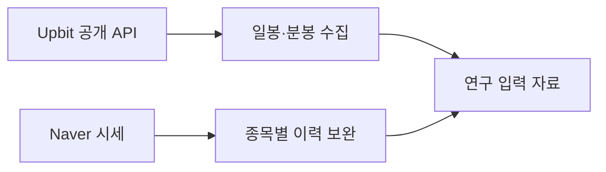

# Market Data API

**금융 연구용 Upbit·Naver 시세 수집 코드**

[Upbit 일봉](upbit/fetch_daily.py) · [Upbit 분봉](upbit/fetch_minutes.py) · [Naver 시세](naver/kospi200_full_history.py)

## 수집 범위

| 소스 | 수집 대상 | 처리 |
|---|---|---|
| Upbit 공개 API | BTC/KRW 일봉 | 페이지 순회 |
| Upbit 공개 API | BTC/KRW 1분봉 | 월별 저장 · 재시도 · 속도 제한 · 재개 |
| Naver HTTP | KOSPI200 편입 이력 종목 시세 | 전체 가격 수집 · 기존 자료 보완 |

Upbit 코드는 인증키 없이 공개 시세를 조회한다. 주문 기능은 포함하지 않는다.

## 연결된 연구

- [Bitcoin Volatility Research](https://github.com/Kimjongyeop-web/bitcoin-volatility-research): BTC 실현변동성과 HAR 예측
- [KOSPI200 PCA Reversal](https://github.com/Kimjongyeop-web/kospi200-pca-reversal): 단기반전 공동 연구
- [Commodity Risk DGRI](https://github.com/Kimjongyeop-web/commodity-risk-dgri): 별도 GDELT 뉴스 수집 코드

입력과 실행 환경

Upbit 스크립트는 현재 작업 폴더의 `work/`를 사용한다. 분봉 수집기는 완료된 임시 partial 파일을 제거한다. 실행 폴더는 보존 원본 폴더와 분리된다.

Naver 코드는 스크립트 상단에 정의된 분석·QC Excel을 입력으로 사용한다. 필요한 패키지는 `requirements.txt`에 있다. `python prepare_run.py --run-id research_001`은 실행별 소스 복사본과 빈 작업 폴더를 구성한다.

서버 응답과 호출 제한은 변경될 수 있으며 현재 API 동작은 별도 검증이 필요하다.

[데이터 범위](DATA_POLICY.md)
